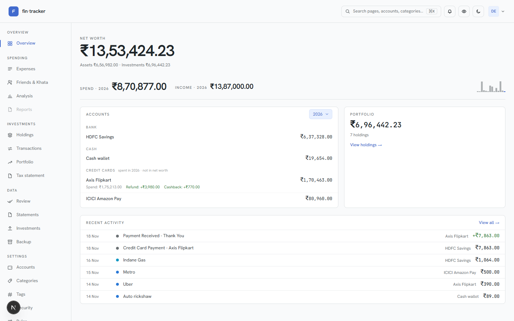
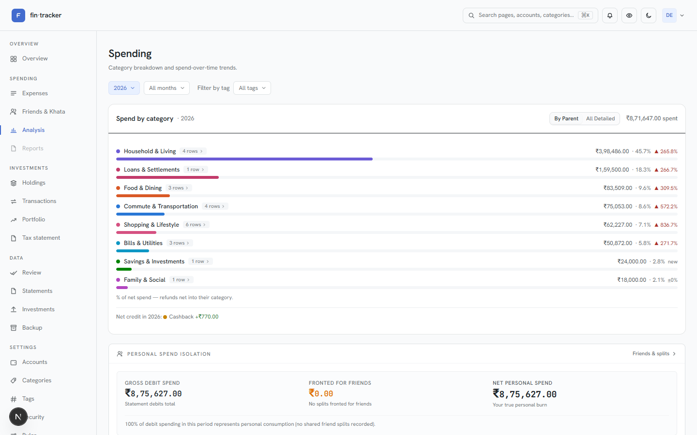
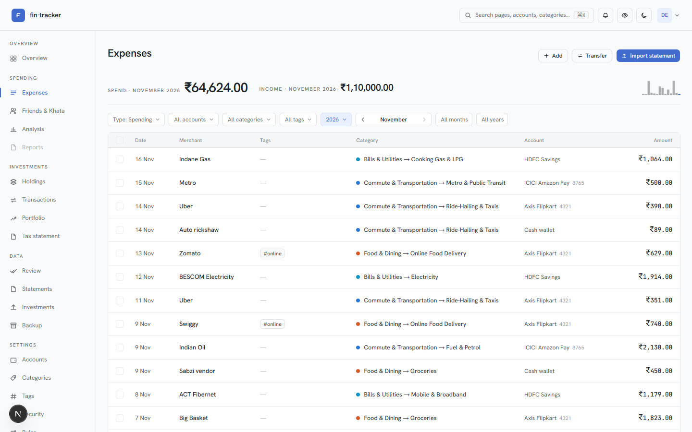
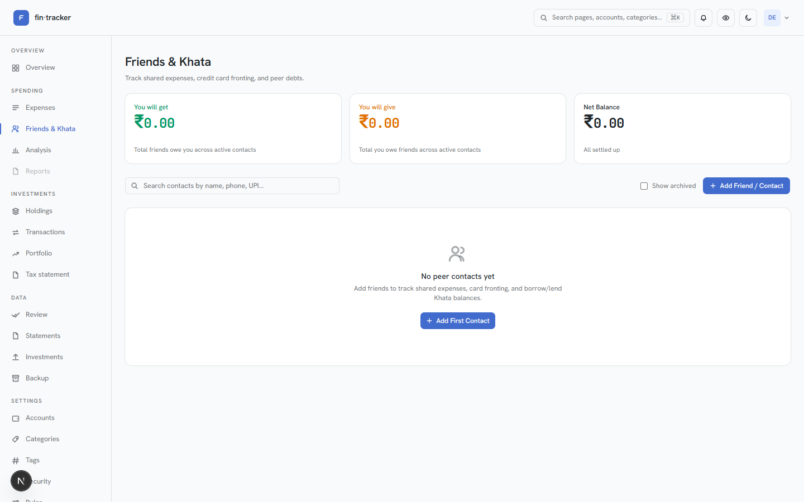
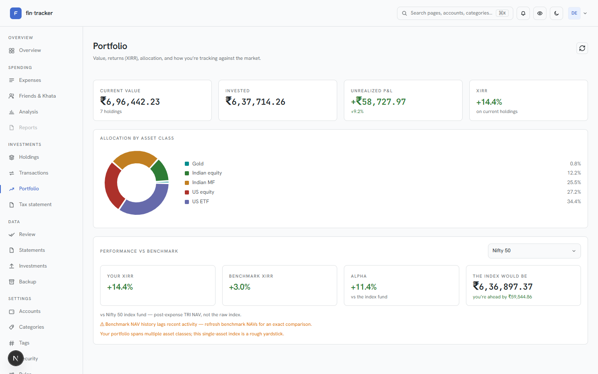
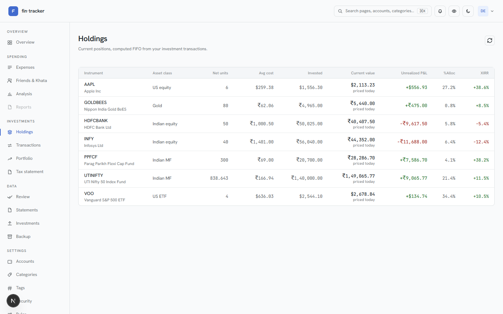
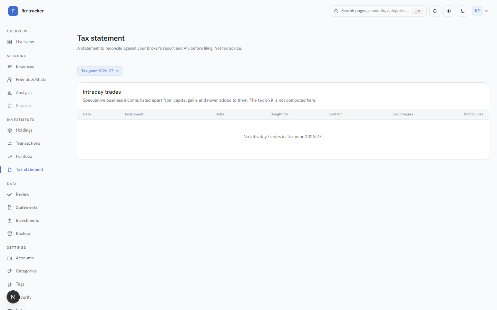

# Fin Tracker

A privacy-first, self-hosted personal finance tracker for Indian banks and global investments — import statements, auto-tag transactions, manage hierarchical categories, track an INR+USD portfolio with proper XIRR, and analyze spending trends locally.


[](https://fin-tracker-demo.fastapicloud.dev)

> [!NOTE]
> **Live Demo**: Click **Try the demo** at [fin-tracker-demo.fastapicloud.dev](https://fin-tracker-demo.fastapicloud.dev) to get your own throwaway sandbox with synthetic sample data. Guest sandboxes cannot upload files and expire after 2 hours; the showcase is rebuilt nightly.
>
> **Privacy-First & Self-Hostable**: For personal use, run it on your own machine with SQLite/Docker — your statements, transactions, and portfolio data never leave it. See the [FastAPI Cloud Deployment Guide](docs/deploy/FASTAPI_CLOUD.md) for self-hosting a public, demo-only showcase.

## Screenshots

| Overview & Net Worth | Spending Analysis |
| :---: | :---: |
|  |  |

| Expenses & Custom Labels | Friends & Khata (Peer Ledger) |
| :---: | :---: |
|  |  |

| Portfolio Performance & Benchmarks | Investment Holdings |
| :---: | :---: |
|  |  |

| Tax Statement & Capital Gains |
| :---: |
|  |

## Key Features

- 📥 **Statement Import & Review Queue**: Password-protected **PDF** statements from six issuers — credit cards (**Axis**, including the Flipkart co-brand, and **ICICI**) and savings accounts (**HDFC**, **ICICI**, **SBI**, **Axis**). Every bank-statement row is checked against the printed running balance, and a mismatch is an error rather than a guessed import. Parsed rows land in an interactive review queue (`/imports/review/[batchId]`) before anything is committed; bundled sample statements let you try the flow with no real data.
- 🔁 **Duplicate Detection & Reconciliation**: Per-row fingerprints make re-importing a statement safe. Credit-card bill payments are paired with the matching bank debit as a transfer (excluded from spend), and refunds and cashback net against spend instead of inflating income.
- 🏷️ **Hierarchical 2-Level Categories**: A parent → subcategory tree (ADR-0012) with separate spend and income kinds, one-hop rollup, color inheritance, archiving, and a command-palette (`cmdk`) category selector.
- 🤖 **Smart Auto-Tagging & Merchant Aliases**: Learns merchant→category mappings and canonical merchant aliases from your own corrections, manageable under **Settings → Rules**.
- ✍️ **Expenses Board & Manual Entry**: Fast transaction management with manual entry, multi-select batch edits, custom transaction labels, and one-click balance masking for over-the-shoulder privacy.
- 👥 **Peer Ledger & Friends Dues (Khatabook)**: Track money fronted for friends on credit cards, split restaurant bills, and personal loans (`/friends`). Supports upfront card discount/cashback offsets, dynamic running balances ("You will get" / "You will give"), atomic full settlements, personal spend isolation on dashboard tiles ("Card Used by Friends"), and CSV export of contact ledgers.
- 📊 **Spending Analytics**:
  - Spend-by-category overview with parent → subcategory drilldown, plus weekly/monthly spend bars.
  - Category trend (`CategoryTrendBar`: top six parents, drilldown, year markers).
  - Summary strip with yearly/monthly spend and income, month-over-month change, and a 14-week sparkline.
  - Net worth from bank/cash balances plus portfolio value.
- 📈 **Investments & Portfolio Tracking**:
  - Canonical transaction-CSV and Excel (`.xlsx`) import for MFs & equities (header aliases are seeded with Zerodha Console's tradebook, so most broker exports import without renaming).
  - US stocks/ETFs via INDmoney transaction export, with FX stamped at each transaction date.
  - INR home currency with USD investment rollup.
  - Manually triggered NAV/price refresh (AMFI NAVAll for mutual funds, a public quote feed for Indian equities).
  - Whole-portfolio XIRR and alpha against Indian benchmark index funds, including the rupee gap.
- 🧾 **Tax & Capital Gains Reporting**: Financial-year capital-gains statement (FIFO lot matching, STCG / LTCG / debt-slab buckets, ₹1.25L equity-LTCG exemption), dividend-income summary, and a separate intraday-trades listing. These are statements to reconcile against your broker/AMC reports and AIS / Form 26AS — not tax advice.
- 💾 **Backup & Restore**: **Settings → Backup** downloads a zip of CSVs (`metadata.json`, `accounts.csv`, `categories.csv`, `transactions.csv`) and restores it additively — rows already present are skipped, never overwritten. Investments round-trip through the investment importer instead.
- 🔒 **Multi-User Tenant Isolation**: Cookie-based JWT sessions with rotating refresh tokens, argon2id password hashing, idle and absolute session timeouts, and strict per-row tenant isolation (`user_id`). After the first account registers, registration is closed unless you enable it.

Full scope in [PRD.md](PRD.md).

### Not built yet

Statement import is PDF-only (no CSV or netbanking-XLS parser). Google Drive sync, scheduled NAV refresh, capital-loss set-off, and a net-worth-over-time trend are specced in the PRD but not implemented. See [PRD.md § Roadmap](PRD.md#roadmap).

## Architecture

```
                           ┌────────────────────────────────────────────────────────┐
                           │   Browser (Next.js 16 App Router + TanStack Query v5)  │
                           └───────────────────────────┬────────────────────────────┘
                                                       │ HTTP / JSON (Cookie JWT)
                                                       ▼
┌───────────────────────────┐   ┌───────────────────────────────────────────────────┐
│   PDF / CSV statements    │──▶│      FastAPI Backend (Python 3.14)                │
│  (Bank PDFs, Broker CSV)  │   │  • Parsers (pdfplumber + pikepdf)                 │
└───────────────────────────┘   │  • Services (dedup, auto-tagging, XIRR, backup)   │
                                │  • SQLAlchemy 2.0 (naive UTC clock, tenant-bound) │
                                └─────────────────────────┬─────────────────────────┘
                                                          │
                                                          ▼
                                ┌───────────────────────────────────────────────────┐
                                │             SQLite Database / Postgres            │
                                └───────────────────────────────────────────────────┘
```

The frontend uses Next.js 16 App Router with React 19 and TanStack Query v5 for client state management. Pydantic schemas are hand-mirrored as TypeScript types in `frontend/lib/api/client.ts`. Live tiles use TanStack Query invalidation contracts (`lib/queries/invalidate.ts`) to keep views synchronized. Migrations apply automatically when the backend boots in Docker.

### Project layout

```
backend/    FastAPI app (api/, services/, parsers/, models/, schemas/, core/), Alembic migrations, pytest suite
frontend/   Next.js app (app/ routes, components/, lib/), Vitest tests
docs/       ADRs (docs/adr), local-setup and deploy guides, research notes
deploy/     Caddyfile for the optional reverse-proxy stack
scripts/    Source packaging and fixture redaction helpers
```

## Tech stack

| Layer              | Choice                                                                        |
| ------------------ | ----------------------------------------------------------------------------- |
| **Backend**        | Python 3.14 + FastAPI + SQLAlchemy 2.0 + Alembic                              |
| **Database**       | SQLite (with Postgres portability via ADR-0001)                               |
| **Auth**           | `argon2-cffi` password hashing + `PyJWT` cookie sessions                      |
| **PDF Parsing**    | `pdfplumber` + `pikepdf` (per-issuer strategy pattern)                        |
| **Financial Math** | `pyxirr`                                                                      |
| **Frontend**       | Next.js 16 App Router + React 19 + TypeScript + Tailwind CSS 4                |
| **UI Components**  | shadcn/ui (Radix primitives) + Lucide Icons + Recharts                        |
| **State & Cache**  | TanStack Query v5 (manual invalidation architecture)                          |
| **Testing**        | `pytest` + `pytest-xdist` (backend, 75% coverage gate), `vitest` (frontend)   |
| **Tooling & CI**   | `uv` (Python), `pnpm` (Node), `ruff`, Astral `ty`, `eslint`, GitHub Actions   |
| **Reverse Proxy**  | Caddy (optional single-origin Docker stack)                                   |

Full rationale in [PRD.md § Tech stack](PRD.md#tech-stack).

## Deploy with Docker

Run the whole app on your own computer with Docker — your financial data never leaves your machine.

### 1. Install Docker

- **Windows / macOS** — install [Docker Desktop](https://www.docker.com/products/docker-desktop/) and start it.
- **Linux** — install [Docker Engine](https://docs.docker.com/engine/install/) + Compose plugin (v2.24+).

### 2. Configure

```bash
cp .env.example .env
```

Set a real `JWT_SECRET` in `.env`. Without one the app boots with a loud development placeholder, which is only acceptable for throwaway local use:

```bash
python -c "import secrets; print(secrets.token_urlsafe(48))"
```

### 3. Clone and Start

```bash
git clone <repository-url>
cd fin-tracker
docker compose -f docker-compose.yml up -d --build
```

> **Native Linux only**: the backend runs as uid `10001`, so make the data directory writable once before the first start: `mkdir -p data && sudo chown -R 10001:10001 data`. Docker Desktop (Windows/macOS) needs nothing.

### 4. Open the App

Open **http://localhost:3000** and register your account. The first user can always register; afterwards registration is closed unless you set `REGISTRATION_ENABLED=true`. The published demo login stays disabled on self-host stacks by design.

### Managing Docker Containers

| Task            | Command                                                                            |
| --------------- | ---------------------------------------------------------------------------------- |
| **Stop**        | `docker compose -f docker-compose.yml down`                                        |
| **Start again** | `docker compose -f docker-compose.yml up -d`                                       |
| **View logs**   | `docker compose -f docker-compose.yml logs -f`                                     |
| **Update**      | `git pull && docker compose -f docker-compose.yml up -d --build`                   |
| **Back up**     | Stop the container and copy the **`data/`** directory, or use **Settings → Backup** in the app. |

### Reverse Proxy & LAN Access

To access the app across your local network or phone, use the single-origin Caddy stack:

```bash
docker compose -f docker-compose.yml -f docker-compose.proxy.yml up -d --build
```

Access via **http://localhost:8080** (change the port with `PROXY_PORT`). To log in from another device, append that device's origin (for example `http://192.168.1.42:8080`) to `CORS_ALLOWED_ORIGINS` in `.env`; the backend rejects state-changing requests from origins that are not listed. The direct two-port stack bakes in a `localhost` API URL, so it only works from the host machine itself.

---

## Local Development Setup

Full playbook, including dependency updates: [docs/LOCAL_SETUP.md](docs/LOCAL_SETUP.md).

### Prerequisites
- **Python 3.14** + **uv** ([astral.sh/uv](https://docs.astral.sh/uv/))
- **Node 26** (pinned in [`.nvmrc`](.nvmrc)) + **pnpm 11** (`npm install -g pnpm@11.21.0`)
- *(Optional)* **make**

### 1. Backend Setup

```bash
cd backend
uv sync
mkdir -p data                 # SQLite lives here when running from source
uv run alembic upgrade head   # Run database migrations
uv run uvicorn app.main:app --reload
```
API runs at **http://localhost:8000** (interactive Swagger docs at **http://localhost:8000/docs**).

### 2. Frontend Setup

```bash
cd frontend
pnpm install
pnpm dev
```
Frontend runs at **http://localhost:3000**.

### 3. Running with Make (Alternative)

| Target           | What it does                                                                                   |
| ---------------- | ---------------------------------------------------------------------------------------------- |
| `make dev`       | Hot-reload full stack via Docker Compose; seeds the demo dataset and enables the demo login.   |
| `make up`        | Self-host stack (direct two-port, no proxy).                                                   |
| `make up-proxy`  | Self-host stack behind the Caddy reverse proxy.                                                |
| `make migrate`   | Run Alembic migrations.                                                                        |
| `make backend`   | Run the backend locally with uvicorn reload.                                                   |
| `make frontend`  | Run the frontend dev server.                                                                   |
| `make test`      | Full backend suite with the 75% coverage floor.                                                |
| `make test-fast` | Backend inner loop: no coverage, skips real-PDF and `slow` tests.                              |
| `make lint`      | Ruff + ESLint.                                                                                 |
| `make typecheck` | `ty` + `tsc --noEmit`.                                                                         |

---

## Testing & Quality Gates

The project maintains high code quality and strict type safety enforced through local hooks and GitHub Actions CI:

| Task                     | Command                                                              |
| ------------------------ | -------------------------------------------------------------------- |
| **Backend Tests**        | `cd backend && uv run pytest -n auto` (enforces 75% coverage floor)   |
| **Backend Fast Loop**    | `cd backend && uv run pytest --no-cov -m "not real_pdf and not slow" -n auto` |
| **Frontend Tests**       | `cd frontend && pnpm test` (Vitest unit tests)                       |
| **Backend Lint**         | `cd backend && uv run ruff check .`                                  |
| **Backend Typecheck**    | `cd backend && uv run python -m ty check app`                        |
| **Frontend Lint**        | `cd frontend && pnpm lint`                                           |
| **Frontend Typecheck**   | `cd frontend && pnpm typecheck` (`tsc --noEmit`)                      |
| **Pre-commit Checks**    | `cd backend && uv run pre-commit run --all-files`                     |

The fast loop is not the definition of done. Run the full suite before committing, and always after touching a migration, because the fast loop skips the migration upgrade/downgrade tests. Pre-commit runs both type-checkers, ruff, eslint, and the fixture-redaction test, but not the full suites.

### CI/CD Workflows (`.github/workflows/`)

- **`test-backend.yml`**: On Python 3.14, runs Ruff lint and format check, `ty`, and the pytest suite (including the migration stairway tests) with the 75% coverage floor, and uploads the coverage report.
- **`test-frontend.yml`**: Runs ESLint, `tsc --noEmit`, Vitest, and a production `pnpm build`, with Node taken from `.nvmrc`.
- **`docker-build.yml`**: Validates that the Compose images build whenever Dockerfiles, Compose files, or lockfiles change.
- **`security.yml`**: Fails if any `.env*` file other than `.env.example` is committed, and runs the PII fixture-redaction guard.
- **`pre-commit.yml`**: Runs the repo-wide hygiene hooks (whitespace, YAML/TOML validity, merge-conflict markers, line endings, and the `# type: ignore` ban in `backend/app/`). The language-specific hooks are skipped here because the workflows above already cover them.
- **`deploy.yml`**: On push to `main`, nightly at 03:17 UTC, or manually, it validates the Compose build and re-runs the backend, frontend, and security checks, then builds the static frontend into `backend/frontend_dist` and deploys to the FastAPI Cloud demo.
- **Dependabot**: Automated dependency tracking and security patches for GitHub Actions, pip, npm, and Docker.

---

## Configuration

Environment variables live in `.env` at the project root (copy from [.env.example](.env.example), which documents every option in detail). The most useful ones:

| Variable                       | Default                                  | Purpose                                                                                          |
| ------------------------------ | ---------------------------------------- | ------------------------------------------------------------------------------------------------ |
| `JWT_SECRET`                   | dev placeholder                          | Secret for signing JWT session tokens. **Set a real value on any self-host stack.**               |
| `DATABASE_URL`                 | Docker: `sqlite:////data/fin-tracker.db`; from source: `./data` at repo root | Database connection string (SQLite or Postgres).        |
| `API_HOST`                     | `127.0.0.1`                              | Backend bind address (`0.0.0.0` for LAN access).                                                 |
| `API_PORT`                     | `8000`                                   | Backend API port.                                                                                |
| `API_RELOAD`                   | `false`                                  | Enable uvicorn hot reloading in development.                                                     |
| `LOG_FORMAT`                   | `console`                                | Log output format (`console` or `json` for production).                                          |
| `LOG_LEVEL`                    | `info`                                   | App log level (`debug`, `info`, `warning`, `error`).                                             |
| `PROXY_PORT`                   | `8080`                                   | Host port published by the Caddy proxy stack.                                                    |
| `REGISTRATION_ENABLED`         | `false`                                  | Allow new sign-ups after the first user. The first user can always register.                     |
| `DEMO_LOGIN_ENABLED`           | off                                      | Enable the published demo account. Leave off for any stack another device can reach.             |
| `GUEST_SANDBOX_ENABLED`        | `false`                                  | Enable throwaway guest sandboxes (the hosted-demo mode).                                         |
| `MAX_GUEST_ACCOUNTS`           | `100`                                    | Cap on simultaneously live guest sandboxes.                                                      |
| `SESSION_IDLE_TIMEOUT_MINUTES` | `30`                                     | A session dies after this long idle.                                                             |
| `SESSION_ABSOLUTE_TTL_HOURS`   | `12`                                     | A session dies this long after login, however active.                                            |
| `COOKIE_SECURE`                | `false`                                  | Set to `true` behind any HTTPS terminator.                                                       |
| `COOKIE_SAMESITE`              | `lax`                                    | Cookie SameSite policy; widen only if the frontend is on a different site.                       |
| `CORS_ALLOWED_ORIGINS`         | unset (proxy stack sets loopback origins) | Comma-separated browser origins allowed to call the API.                                        |
| `RATE_LIMIT_TRUST_PROXY`       | unset                                    | Key the auth rate limiter on `X-Forwarded-For`; only behind a proxy you control.                 |
| `FRONTEND_DIST_DIR`            | unset                                    | Serve a static frontend build from FastAPI (used by the FastAPI Cloud deploy).                   |
| `V1_USER_ID`                   | `00000000-0000-0000-0000-000000000001`   | Fixed UUID of the seeded first user; the app refuses to boot if it does not match.               |
| `AMFI_NAVALL_URL`, `YAHOO_QUOTE_BASE_URL`, `MFAPI_BASE_URL`, `NAV_FETCH_TIMEOUT_SECS` | public feeds, `5.0` s timeout | Price and NAV feed endpoints; override only to use a mirror. |

The `*_TEST_PWD` variables in `.env.example` only supply passwords for your own gitignored statements in the real-PDF parser tests.

---

## Troubleshooting

- **`uv sync` fails with TLS / certificate errors**: Force the public PyPI index: `UV_INDEX= uv sync`.
- **VS Code shows missing Python imports**: Press `Ctrl+Shift+P` → "Python: Select Interpreter" → choose `backend/.venv/Scripts/python.exe`.
- **`pnpm: command not found` on Windows**: Ensure `%APPDATA%\npm` is added to your user PATH: `setx PATH "%PATH%;%APPDATA%\npm"`.
- **`pnpm install` postinstall script errors**: `frontend/pnpm-workspace.yaml` is configured to build `sharp` and `unrs-resolver`. If shims break on Windows, run `corepack pnpm install --force`.
- **Corporate TLS Proxy / Zscaler**: Price feeds fail with `CERTIFICATE_VERIFY_FAILED` behind a TLS-inspecting proxy. See [frontend/certs/README.md](frontend/certs/README.md) for the `ca-bundle` automatic merge workflow (`make backend` applies it).
- **Backend fails to open SQLite on native Linux**: The container runs as uid `10001`; run `mkdir -p data && sudo chown -R 10001:10001 data`.
- **Login returns 403 from another device**: Add that device's origin (for example `http://192.168.1.42:8080`) to `CORS_ALLOWED_ORIGINS` in `.env`, then restart the stack.
- **Demo login is refused**: By design. The demo credentials are public, so `DEMO_LOGIN_ENABLED` must be set explicitly, and only on a throwaway dev box (`make dev` does this for you).

---

## Documentation

- [PRD.md](PRD.md) — product requirements, feature specs (F1–F11), data model, roadmap.
- [GLOSSARY.md](GLOSSARY.md) — domain terms, defined once.
- [docs/adr/](docs/adr/README.md) — architecture decision records.
- [docs/LOCAL_SETUP.md](docs/LOCAL_SETUP.md) — running from source and updating dependencies.
- [docs/deploy/FASTAPI_CLOUD.md](docs/deploy/FASTAPI_CLOUD.md) — deploying the demo-only showcase.
- [AGENTS.md](AGENTS.md) — conventions for coding agents working in this repo.

---

## Contributing

Contributions, issues, and feature requests are welcome! Feel free to open an issue or submit a pull request.

Before submitting a pull request, ensure all test suites and linting checks pass:

```bash
# Backend validation
cd backend && uv run pytest -n auto && uv run ruff check . && uv run python -m ty check app

# Frontend validation
cd frontend && pnpm test && pnpm typecheck && pnpm lint
```

---

## License

Distributed under the MIT License. See [LICENSE](LICENSE) for more details.
